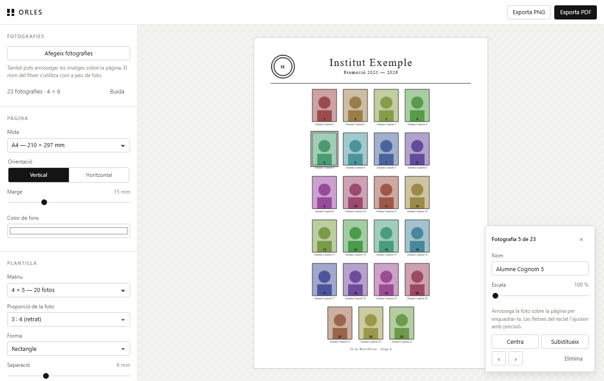

# Orles

Aplicació web per compondre una orla d'una sola pàgina amb plantilles de matrius
predefinides i exportar-la en PDF llest per imprimir.

**Aplicació en línia: <https://vmoren12.github.io/orles/>**

Funciona íntegrament al navegador: no hi ha servidor, no cal instal·lar res i les
fotografies no surten mai de l'ordinador.



## Funcions

- **Plantilles de matriu predefinides**: de 2 × 3 fins a 6 × 8, o bé automàtica,
  que tria el nombre de columnes que fa les fotografies tan grans com es pugui.
- **Pàgina**: A4, A3, A2 o Carta, en vertical o horitzontal, amb marge ajustable.
- **Fotografies**: s'afegeixen amb el botó o arrossegant-les sobre la pàgina.
  El nom del fitxer es converteix automàticament en el peu de foto.
- **Enquadrament còmode**: arrossega una foto per moure-la dins del seu marc,
  fes girar la roda del ratolí per ampliar-la i afina-ho amb les fletxes del teclat.
  El botó *Centra* la retorna a l'enquadrament inicial.
- **Intercanvi de fotos**: passa el ratolí per sobre d'una foto i arrossega la
  nansa ⇄ de la cantonada fins a una altra foto; les dues es canvien de lloc.
- **Composició**: proporció 3:4, 4:5, 1:1 o 4:3, cantonades rectes, arrodonides o
  ovalades, filet opcional i última fila incompleta centrada.
- **Fons**: colors suggerits o qualsevol altre, estampats suaus (punts,
  quadrícula, ratlles, rombes, ones, estrelles, confeti o marc clàssic) amb color,
  intensitat i mida ajustables, i també una imatge de fons pròpia (omplint la
  pàgina, sencera o en mosaic) amb la intensitat que vulguis.
- **Textos**: títol, subtítol i peu de pàgina, amb tipografia serif o sans-serif,
  mides i colors ajustables.
- **Segell del centre** opcional, a l'esquerra, a la dreta o sobre el títol.
- **Exportació**: PDF a 150 o 300 ppp, i també PNG. Al PDF els textos són
  vectorials i només es rasteritzen les fotografies i, si n'hi ha, el fons decorat.
- La configuració es recorda al navegador entre sessions (les fotografies i la
  imatge de fons, no).

## Com s'utilitza

1. Obre <https://vmoren12.github.io/orles/>.
2. Afegeix les fotografies. Si els fitxers es diuen `01 - Anna Puig.jpg`,
   `02 - Bernat Solé.jpg`…, els noms i l'ordre ja surten bé d'entrada.
3. Tria la matriu, l'orientació i la mida de pàgina.
4. Fes clic a una fotografia per seleccionar-la i enquadrar-la o canviar-ne el nom.
5. Escriu el títol, el subtítol i, si vols, carrega el segell del centre.
6. Prem **Exporta PDF**.

### Dreceres

| Acció | Drecera |
| --- | --- |
| Seleccionar una fotografia | clic |
| Moure la imatge dins del marc | arrossegar |
| Intercanviar dues fotos | arrossegar la nansa ⇄ de la cantonada (`Esc` cancel·la) |
| Ampliar o reduir | roda del ratolí |
| Ajust fi de l'enquadrament | fletxes (amb `Maj`, passos més grans) |
| Substituir la imatge | doble clic |
| Eliminar la fotografia | `Supr` |
| Desseleccionar | `Esc` |

## Publicació a GitHub Pages

El repositori ja conté tot el que cal (lloc estàtic a l'arrel i fitxer
`.nojekyll`). Per activar la publicació:

1. Ves a **Settings** del repositori → apartat **Pages** (menú de l'esquerra).
2. A **Build and deployment** → **Source**, tria **Deploy from a branch**.
3. A **Branch**, selecciona **`main`** i la carpeta **`/ (root)`**. Prem **Save**.
4. Al cap d'un o dos minuts el lloc queda publicat a
   <https://vmoren12.github.io/orles/>. Pots seguir el desplegament a la pestanya
   **Actions** del repositori.

Per deixar l'enllaç ben visible, obre la pàgina principal del repositori, prem
l'engranatge del bloc **About** (a la dreta) i emplena:

- **Description**: `Generador d'orles en PDF, 100 % al navegador — https://vmoren12.github.io/orles/`
- **Website**: `https://vmoren12.github.io/orles/`
- Marca **Use your GitHub Pages website** si vols que l'enllaç s'ompli sol.

## Desenvolupament

No hi ha cap pas de compilació ni cap dependència que calgui instal·lar. N'hi ha
prou amb servir la carpeta:

```sh
git clone https://github.com/vmoren12/orles.git
cd orles
python -m http.server 8000
# obre http://localhost:8000
```

### Estructura

```
index.html                 interfície
assets/css/styles.css      estils
assets/js/templates.js     mides de pàgina, proporcions i tria de columnes
assets/js/layout.js        càlcul de la composició en mil·límetres
assets/js/renderer.js      dibuix sobre canvas (previsualització i PNG)
assets/js/export.js        generació del PDF i descàrregues
assets/js/app.js           estat, controls i interacció
```

`layout.js` calcula una llista d'operacions de dibuix (rectangles, línies, textos
i imatges) en mil·límetres de pàgina. Aquesta mateixa llista l'interpreten dos
motors diferents: `renderer.js` per pintar-la en un canvas i `export.js` per
escriure-la en un PDF. Per això la previsualització i el document final
coincideixen.

L'única dependència externa és [jsPDF](https://github.com/parallax/jsPDF), que es
carrega des d'un CDN al `index.html`.

### Limitacions conegudes

- El PDF utilitza les tipografies estàndard del format (Times i Helvetica), que
  cobreixen l'alfabet llatí occidental. Els caràcters fora d'aquest joc no es
  representen.
- Amb moltes fotografies a 300 ppp la generació pot trigar uns segons i el fitxer
  resultant pot ocupar diversos megabytes.

## Llicència

[MIT](LICENSE)
